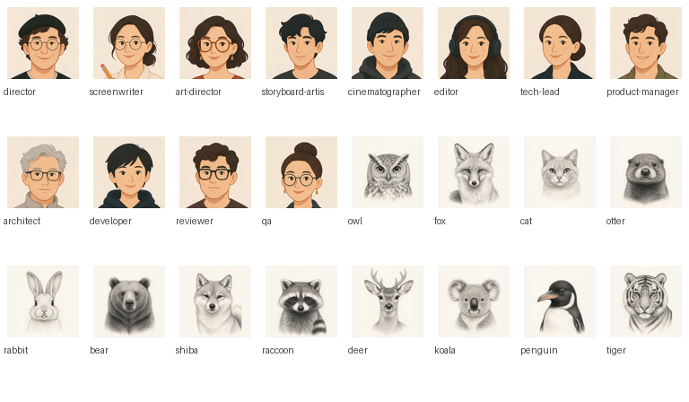
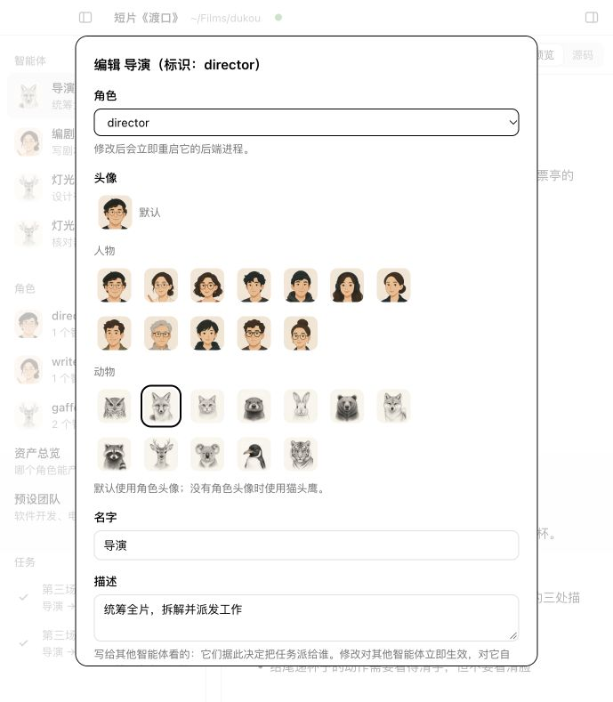

# 智能体头像

应用内置 24 个静态头像：12 个扁平人物和 12 个素描动物。最终素材放在 `packages/desktop/renderer/avatars/`，每个 PNG 为 192 × 192 像素，总计约 1.3 MB。桌面构建会复制这些图片到 `dist/renderer/avatars/`，安装包包含它们。



人物对应电影和软件团队的全部 12 个角色，中英文的 `role.json` 均通过 `avatar` 字段绑定。智能体和角色编辑页可以从全部头像中选择。

智能体显式设置的头像优先，其次是角色头像，最后是默认猫头鹰 `animal-owl`。旧工作区没有 `avatar` 字段也可直接使用。未知 ID 会回退到角色头像或默认头像。`avatar: ""` 表示使用默认；部分更新省略该字段表示保留原值。智能体保存到现有状态存储，角色保存到 `role.json`。修改头像不会重启后端进程，角色头像变化会立即更新继承它的侧栏和对话栏。

头像 ID 是本地素材名，界面通过白名单解析到应用内的 PNG；不接受外链或文件路径。应用运行时只读取已经生成的图片，不调用语言模型或图像模型，也不需要 Ark 登录或网络。媒体生成角色现有的出图工具独立于头像功能。

## 生成记录

2026-11-17，经本机官方 `arkcli` 验证：`arkcli resources list --modality image` 返回 Seedream Pro 和 Flash 可调用，当前默认模型为 `doubao-seedream-5.0-pro`。两次真实生成均返回 `status: succeeded`，模型为 `doubao-seedream-5.0-pro`。

使用用户指定的 Ark CLI 生成两张 2048 × 2048 的图集，然后离线裁切、缩小为独立 PNG。没有使用 OpenAI CLI。两次命令参数相同：

```sh
arkcli +gen '<下方提示词>' --modality image --size 2048x2048 \
  --output-format png --watermark=false --save-to '<临时素材目录>' \
  --no-open --no-gallery
```

人物提示词（原样）：

> 为智能体应用制作一张精致头像素材图集，严格4列3行共12格，整幅正方形，每格尺寸完全一致，无格线，无文字，无标签，无水印。每格一个独立居中的头肩人物头像，四周留白，各格人物不能跨格。统一现代扁平编辑插画风格，干净几何色块，少量深色轮廓线，温暖低饱和色，米白背景，五官清晰，成熟友好，头占每格约60%，方便裁成小头像，男女均衡，不要3D。按从左到右从上到下顺序：第一行 导演戴黑色贝雷帽和圆眼镜、编剧女性握铅笔戴细框眼镜、美术指导女性短波浪发穿赭红色衣服、分镜师青年手拿小速写本；第二行 摄影师戴针织帽身前小相机、剪辑师女性戴监听耳机、技术负责人女性深蓝色外套、产品经理男性穿绿色衬衫；第三行 架构师男性银发眼镜、开发者女性深色短发连帽衫、代码审查者男性棕发方框眼镜、测试工程师女性丸子头戴圆眼镜。专业有个性，形象之间明显可区分。

动物提示词（原样）：

> 为智能体应用制作一张精致动物头像素材图集，严格4列3行共12格，整幅正方形，每格尺寸完全一致，无格线，无文字，无标签，无水印。每格一个独立居中的动物头部及一点肩部，四周留白，不要跨格。统一手绘铅笔与炭笔素描插画，生动清晰的黑灰线条，少量柔和纸纹，温暖米白背景，温柔聪慧有个性，成熟编辑插画而非幼稚卡通，正面或微微侧面，动物头占每格约65%，小头像仍然清晰。按从左到右从上到下顺序：第一行 猫头鹰、狐狸、猫、水獭；第二行 兔子、熊、柴犬、浣熊；第三行 鹿、考拉、企鹅、老虎。各格相同缩放比例与相同纸色。不要边框，不要额外道具，不要彩色，不要摄影不要3D。

人物从每列 x = 68、555、1043、1531，每行 y = 67、713、1367 的位置裁取 450 × 450 方块，以头像为中心。动物按 4 × 3 等分去掉每格 18 像素边缘，保持比例并用米白背景补成方形，保留长耳和鹿角。全部以 Lanczos 缩小到 192 × 192。

## 验证

`npm test`、`npm run typecheck` 和桌面构建通过。新增测试覆盖默认回退、旧工作区、显式选择与清空、保存后重新加载、部分更新保留字段、非法路径拒绝，以及全部头像资源和中英文预设绑定。

浏览器验证使用桌面构建产物和 mock 工作区：头像全部加载成功，狐狸选项可选中，保存后侧栏立即显示狐狸。此处展示的是 mock 工作区，不是用户正在运行的项目。


