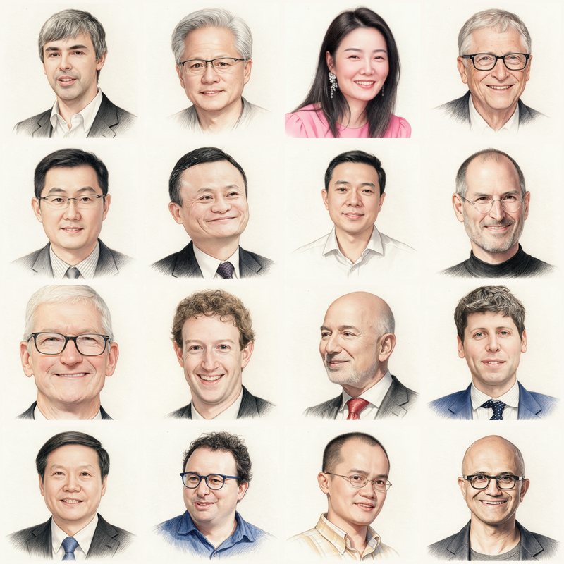

# 智能体头像

应用内置 28 个静态头像：16 位科技人物的彩色铅笔素描，加上 12 个素描动物。最终 PNG 在 `packages/desktop/renderer/avatars/`，均为 192 × 192 像素，随桌面构建和安装包提供。

单张头像与最终预览网格均不叠加人名或其他文字。人物组成 4 × 4 网格：拉里·佩奇、黄仁勋、黄乐、比尔·盖茨、马化腾、马云、李彦宏、乔布斯、蒂姆·库克、扎克伯格、贝索斯、山姆·奥特曼、雷军、Dario Amodei、王兴、萨提亚·纳德拉。黄乐采用灿烂露齿笑容、深色长发、银色垂坠耳饰和粉色连衣裙，头像只包含她本人。



## 绑定与兼容

中英文电影、软件团队的全部 12 个角色通过 `role.json` 中的 `avatar` 绑定人物头像。头像选择器仅显示图像，不叠加人名；角色名称和角色说明由原有预设管理。

| 角色 | 默认头像 |
| - | - |
| 导演 | 拉里·佩奇 |
| 编剧 | 马云 |
| 美术指导 | 黄乐 |
| 分镜师 | Dario Amodei |
| 摄影师 | 黄仁勋 |
| 剪辑师 | 蒂姆·库克 |
| 技术负责人 | 乔布斯 |
| 产品经理 | 马化腾 |
| 架构师 | 比尔·盖茨 |
| 开发者 | 李彦宏 |
| 审查者 | 山姆·奥特曼 |
| 测试工程师 | 萨提亚·纳德拉 |

已保存的旧编号（如 `person-director`）通过 `avatar-catalog.js` 的 `LEGACY_AVATARS` 映射到新编号（如 `person-larry-page`），已存在的智能体和自定义角色无需改配置。旧编号在选择器中也能显示选中状态。

智能体设置的头像优先，其次是角色头像，最后是默认猫头鹰 `animal-owl`。旧工作区没有 `avatar` 字段也可直接使用；未知编号回退。`avatar: ""` 表示使用默认，部分更新省略该字段表示保留原值。修改头像不会重启后端进程。

应用运行时只读取本地 PNG，不调用语言模型或图像模型，不依赖 Ark 登录或网络。图片通过本地白名单解析，不接受外链或文件路径。

## 绘制记录

人物最终风格为彩色铅笔素描：米白纸纹、细腻彩铅笔触、柔和排线和淡彩叠涂。人物逐个绘制，再组成 4 × 4 预览；黄乐首张成功头像被用作整套风格参考，随后只修改服装为粉色连衣裙。

使用本机官方 `arkcli` 和 `doubao-seedream-5.0-pro`，生成输出 2048 × 2048，再以 Lanczos 缩小到 192 × 192。所有生成均在开发阶段完成。动物保留上一版静态素描素材。

```
arkcli +gen '<提示词>' --modality image --size 2048x2048 \
  --output-format png --watermark=false --input reference_image:@<身份参考> \
  --input reference_image:@<风格参考> --inline-local \
  --save-to <输出目录> --no-open --no-gallery
```

单人基础提示词：

> 将图一中的人物重新绘制成精致的彩色铅笔素描头像。这是一张手绘人物肖像，细腻彩铅线条、可见的纸张纹理、温暖的淡彩层层叠涂、克制的排线与轻柔明暗，保留参考人物的真实脸型、发型、眼镜、耳饰与辨识度。完全不要像素色块、马赛克、游戏风格、扁平矢量、照片质感或3D。只画一个人物，完整头发和头顶，头肩近景，人物居中，头部占图幅约70%，四周留白，背景干净暖米白纸，不画原照片背景、文字、标志、其他人或道具，不要边框和水印。自然亲切的表情。适合智能体应用的小头像，面部清晰，整套编辑插画风格统一。

批次参考约束：

> 图一仅用来确定本次人物的身份、脸型、发型和眼镜，图二仅用来统一彩色铅笔笔触、纸色和绘制质量。必须画图一的人，不画图二的女性、不融合两个人的脸。适度友好微笑。

Dario Amodei 身份约束：

> 保留照片中的深蓝色方形全框眼镜、蓝色镜腿、圆润脸型、蓬松黑色卷发、真实年龄和蓝色衬衫。去掉话筒和手，只有本人。

黄乐粉色连衣裙编辑提示词：

> 精确编辑图一：只把女性的白色衣服改成柔和明亮的粉色连衣裙，圆领或自然V领，保留当前头肩头像构图，不需要展示全身。完全保持同一个人的脸型、五官、灿烂露齿笑容、笑眼、肤色、深色长发、银色垂坠耳饰、头部大小、背景和纸张纹理。保持原图细腻的彩色铅笔素描笔触与淡彩叠涂质感。只修改服装颜色和款式，其余不要改动。背景暖米白，只有她一个人，不要文字、边框、水印。

## 肖像参考来源

下列公开照片用于人物形象参考。原始照片及其裁切参考不随应用分发；原图署名与许可见来源页。图像经过单人裁切、彩色铅笔风格重新绘制与缩小。

| 人物 | 来源 | 原图署名与许可 |
| - | - | - |
| 拉里·佩奇 | [公开肖像](https://commons.wikimedia.org/wiki/File:Larry_Page_in_the_European_Parliament,_17.06.2009_(cropped_2).jpg) | 原图署名与许可见来源页 |
| 黄仁勋 | [公开肖像](https://commons.wikimedia.org/wiki/File:Jensen_Huang_Stanford_2026-04-30_010_(cropped).jpg) | Anderseidesvik；CC BY-SA 4.0 |
| 黄乐 | [笑容参考照片](https://www.zaobao.com.sg/news/world/story20261110-9974063) | 联合早报公开照片；仅作单人头像参考 |
| 比尔·盖茨 | [公开肖像](https://commons.wikimedia.org/wiki/File:Bill_Gates_at_the_European_Commission_-_P067383-987995_(cropped)_5.jpg) | Bogdan Hoyaux / European Union；CC BY 4.0 |
| 马化腾 | [公开肖像](https://commons.wikimedia.org/wiki/File:%E9%A9%AC%E5%8C%96%E8%85%BE_Pony_Ma_2019.jpg) | 中国新闻网；CC BY 3.0 |
| 马云 | [公开肖像](https://commons.wikimedia.org/wiki/File:20th_Anniversary_Schwab_Foundation_Gala_Dinner_(44887783681)_(cropped).jpg) | Foundations World Economic Forum；CC BY 2.0 |
| 李彦宏 | [公开肖像](https://commons.wikimedia.org/wiki/File:Robin_Li_(2020).png) | 中国新闻社；CC BY 3.0 |
| 乔布斯 | [公开肖像](https://commons.wikimedia.org/wiki/File:Steve_Jobs_Headshot_2010_(cropped_6).jpg) | Matthew Yohe；CC BY-SA 3.0 |
| 蒂姆·库克 | [公开肖像](https://commons.wikimedia.org/wiki/File:Tim_Cook_in_New_York_City_-_2026_(cropped).jpg) | Dati Bendo / European Union；CC BY 4.0 |
| 扎克伯格 | [公开肖像](https://commons.wikimedia.org/wiki/File:P20260929DT-1655_(55561811540)_(cropped_2).jpg) | The White House；Public domain |
| 贝索斯 | [公开肖像](https://commons.wikimedia.org/wiki/File:260202-D-PM193-2205_SECWAR_Arsenal_of_Freedom_Tour_-_Florida_(3x4_cropped_on_Bezos_and_rotated).jpg) | SECWAR；Public domain |
| 山姆·奥特曼 | [公开肖像](https://commons.wikimedia.org/wiki/File:Meeting_with_Masayoshi_Son_and_Sam_Altman_(February_3,_2025)_(3x4_cropped_on_Altman).jpg) | 首相官邸ホームページ / Office of the Prime Minister of Japan Official Website；CC BY 4.0 |
| 雷军 | [公开肖像](https://commons.wikimedia.org/wiki/File:PM_Sanchez_with_Lei_Jun_(2026)_(cropped_2).jpg) | Pool Moncloa/Borja Puig de la Bellacasa；Attribution |
| Dario Amodei | [公开肖像](https://commons.wikimedia.org/wiki/File:Dario_Amodei_at_TechCrunch_Disrupt_2023_01_(cropped).jpg) | 原图署名与许可见来源页；保留蓝色眼镜、卷发和蓝色衬衫 |
| 王兴 | [公开肖像](https://commons.wikimedia.org/wiki/File:Wang_Xing_in_2009.jpg) | X/Media/Lab；CC BY 2.0 |
| 萨提亚·纳德拉 | [公开肖像](https://commons.wikimedia.org/wiki/File:MS-Exec-Nadella-Satya-2017-08-31-22_(cropped).jpg) | Brian Smale and Microsoft；CC BY-SA 4.0 |
