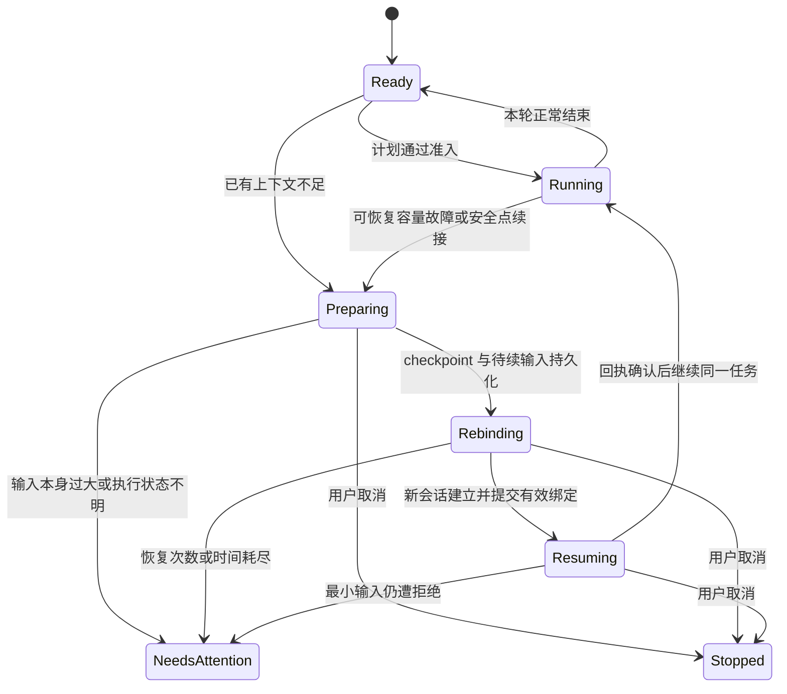

# xSB 上下文生命周期设计

状态：系统设计与实现记录。设计于 2026-11-20；核心修复于 2026-11-21 落地，实施范围见第 13 节。

## 1. 目标与结论

长期对话、多 Agent 协作和后台任务持续运行时，上下文应有可解释的容量边界；超过边界应能安全续接，且不丢失用户指令、不重复副作用、不让基础设施故障扩散成整个团队的任务失败。

核心设计是：用户对话保持稳定，任务状态由 Hub 持久化，模型上下文按需要更新。每个 Agent 仍只有一个工作执行序列，不引入多个同时写同一工作区的后端会话。容量管理覆盖输入编排、工具返回、历史续接和恢复，而不是只在报错时重开会话。

此前 `session.ts` 的补丁只能作为应急兜底：识别长度错误、废弃旧后端会话、下一轮交接。它没有解决同一轮增长、超大的首条输入、安全恢复当前任务、消息确认和多 Agent 通知扩散，不能视为本设计已经实现。

## 2. 已确认的事实与尚不能下的结论

实际运行日志中，同一 cso 对话连续出现五次 `Internal error: Prompt is too long`。其最近的 usage 为 45,397 tokens，后端上报 size 为 1,000,000，项目默认更新阈值为 150,000。本机 Claude 配置 `autoCompactEnabled: false`；错误数据只有 `errorKind: invalid_request`，不足以仅靠错误类型定位长度问题。

这些事实说明：后端报告的窗口与实际请求的可接受容量不能直接等同；单一固定阈值无法覆盖此次故障；关闭原生压缩会增加持续增长风险。**不能据此认定服务上限就是 45,397，也不能认定开启压缩就能彻底解决问题。** usage 的统计范围、模型路由、系统说明、图片和工具定义都可能影响实际请求。当前未获得服务端拒绝时的完整 token 计数和真实上限。

代码层面的边界如下：

| 入口 | 目前的行为 | 系统风险 |
| --- | --- | --- |
| `LiveSession.send` | prefaces 与整批输入拼接后发送 | 无合并后的总预算与准入判定 |
| `Delivery.digest` | 全部积压邮件并入下一轮 | 多个合法小输入合计超过容量 |
| `renderResults` | 普通结果与订阅结果批量内联 | 接收方增长不受总量限制 |
| `renderInput` | 新资产全文；改版时 diff 加全文 | 同时占用差异和全文容量 |
| `memoryDigest` | 最多 30 条笔记，笔记正文无总预算 | 首条系统说明也可能过大 |
| `handoff` | 历史部分最多 40,000 字符 | 当前任务、等待项和资产部分在预算之外；首行摘要可能丢失关键约束 |
| `task_status`、`recall`、`load_skill` 等 | 返回完整结果或列表 | 工具返回同样能填满上下文 |
| 后端自带文件、shell、浏览器工具 | 由后端直接执行 | Hub 看不到完整模型请求，不能保证每个工具输出均受控 |
| `Delivery.turnEnded` | 后端失败让任务失败，并向发送方生成通知 | 会话容量故障变成业务失败与额外消息 |

这些是现有实现的结构性风险，不能全部当作此次故障的已证实原因。

## 3. 必须守住的不变量

1. transcript、资产原件、用户原文和任务账本完整保存；模型当前看到的内容可以有限，不等于历史被删除。
2. 用户的最新请求、取消、否定约束、权限要求和验收条件不得被静默截断。不可装入时明确说明原因。
3. 更新上下文不等于取消任务，不改变用户停止对应的 `workGeneration`，不复活已取消的工作。
4. 每个 Agent 同一时刻只有一个有效的执行后端；旧后端的更新、工具请求和权限请求必须受有效绑定与执行标识约束。
5. 只有真实的投递回执或等价的可验证消费事件才能确认邮件；“编排好了”“准备重试”不算投递成功。
6. 单次恢复有次数、时间和成本上限。不能反复重开会话、复制同一输入或制造新失败通知。
7. 工具执行不能假设 exactly-once。已确认、待确认和未执行必须区分；状态不明的外部写入不能自动重做。
8. 模型生成的摘要不能覆盖 Hub 的任务、取消、订阅、资产版本和权限事实。

## 4. 三类身份与持久化状态

| 层次 | 身份与内容 | 生命周期 |
| --- | --- | --- |
| 用户对话 | 现有 sessionId、完整 transcript、可见边界 | 长期稳定 |
| 业务任务 | taskId、任务图、资产、订阅、用户停止代次 | 到业务终态结束 |
| 后端执行 | backendSessionId、contextEpoch、attemptId、模型配置 | 压缩、更新、故障时可替换 |

`contextEpoch` 表示后端上下文的代次，与用户停止用的 `workGeneration` 分开。`attemptId` 表示某次执行尝试。更新后端时不能把同一业务任务伪装成新任务；重试也不能重复派发它已经启动的子任务。

先在调度与会话记录中增加恢复状态，保留既有业务任务的 queued/running/终态语义。不要一开始就把所有任务状态扩展成复杂的新状态机。客户端可以把“任务 running，执行 recovering”显示为“正在恢复上下文”。

需要持久化的最小信息：有效绑定代次、恢复阶段、目标后端配置、checkpoint 引用、待续接输入 id、恢复尝试数、最后可用 usage 及其配置来源。凭据只用于配置隔离，不写入日志或容量记录。

## 5. 容量模型：实际可用容量与可信程度

容量按后端、实际模型/配置以及路由配置隔离。一个 Agent 的失败不能降低整个团队所有模型的窗口；模型切换或路由配置改变后，旧 usage 和估算不能继续当作当前事实。

信息来源按用途区分：

- 后端声明与 usage：可用于估算，但记录统计范围、采样时间和配置标识。
- 项目/后端配置的有效上限：服务经过代理时可显式配置；作为强约束。
- 后端准确计数或准入接口：若能力存在，优先使用，不能假设标准 ACP 已提供。
- 本地估算：文本按对应 tokenizer；未知模型采用保守估计区间。图片按模型规则或保守上界，不能按 base64 字符数计 token。
- 成功/失败观测：用于校准保守策略和诊断，不把失败时的最后 usage 直接记成真实容量。

准入需要保证：

```text
已有上下文上界 + 新输入上界 + 输出预留 + 工具增长预留 + 不确定性余量
    <= 配置与后端能力共同约束的有效容量
```

usage 若已包含系统说明和工具定义，不能再次加算；不包含或统计范围未知时要计入估计区间。输出预留遵循实际 API 的输入/输出限制关系，有独立上限的服务分别校验。

容量未知时使用可配置的保守运行预算，并尽早在安全边界续接。固定“80%”可以作为初始配置之一，但不是通用正确值；策略必须为一次大输入和同一轮的工具增长留出空间。

## 6. ContextPlanner：所有受控入口共享一个预算

新增独立的 `context.ts`，接收结构化片段，输出投递计划，不直接改任务状态或确认邮件。`prompts.ts` 负责表达，`delivery.ts` 负责选消息和回执，`session.ts` 负责执行与续接。

每个片段包含来源、稳定 id/版本、优先级、估算、是否必须逐字保留、是否可摘要，以及原文检索引用。计划必须在最终组合后校验；`message.pre_submit` 的改写也在准入范围内。不能在规划后再无预算追加 preface、通知或 hook 内容。

返回的决策至少区分：直接提交、减少可选内容、先续接、延后非紧急通知、输入本身过大。任务必须依赖的材料不能仅因为优先级低而被隐藏。

### 输入与返回的具体策略

| 内容 | 投递策略 |
| --- | --- |
| 最新用户请求、取消和验收约束 | 必须保留；过大时转为可检索原文并明确处理方式，不能静默缩短指令 |
| 系统说明与工具定义 | 单独预算；精简重复说明，skills 使用索引与按需加载；权限语义不可压缩掉 |
| 资产 | 优先 id、版本、用途与相关章节；diff 和全文择一；不得声称模型已见全文 |
| 任务结果 | 短结论、状态、产物引用和验证证据；完整经过保存在记录中，按需检索 |
| 普通通知 | 按预算分批投递；控制类通知优先，保留公平性和最大等待期限 |
| 工具返回 | 输出分页/摘录及原文引用；重要错误、最终状态和写入回执必须保留 |
| 图片与多模态 | 保留原件；按任务用途送缩略图、裁剪或必要的原图，并计入模型预算 |

用户的一段文本（例如从剪贴板粘贴的大段日志）超过提示预算的一半时，原文完整写入智能体的 context 目录（原子写），模型只收到开头一段和文件路径，按需读文件；记录里仍显示用户发送的原文，不因长度被拒或丢弃。

单条“必需输入 + 最小系统说明 + 预留”超过新会话容量时，重开会话无效。应进入 `input_too_large`：提供文件分段、检索或任务拆解路径，记录哪些内容尚未读取。不能无限尝试续接，也不能假装已理解全文。

结构化工具输出不能任意截断 JSON。分页、摘要和原文引用必须形成有效的响应结构，并保留任务 id、状态、错误和副作用回执。图片、音频等 ContentBlock 按类型处理；分页引用必须延续原访问权限，不能因为移到文件就扩大可读范围。

`subscribe(all/any)` 的业务条件保持原样。很大的 join 用一个完整状态索引、必要结论和可分页结果引用表示，不把它拆成会改变唤醒条件的独立任务结果。`sync` 返回、`wake`、`lazy`、`inbox`、状态查询都必须遵守同一输出预算。

## 7. 记忆与交接：有来源的 checkpoint

交接由两部分组成：Hub 生成的事实快照，以及有出处的语义摘要。模型摘要是辅助材料，失败时仍应能生成最小确定性交接。

事实快照包含：用户当前目标和必须保留的约束、未终结任务及父子关系、有效订阅、资产版本、已确认副作用、待确认执行、未消费输入与停止代次。较大列表以索引和分页引用表示，整个 checkpoint 都受预算约束。

语义摘要包含决策、理由、未决问题和下一步，引用 transcript 的消息/区间与资产版本。不得把旧 turn 中的命令当作新指令重放。用户明确清空上下文后，不能从清空前的摘要重新注入其对话内容；当前任务账本如何展示仍遵循原有清空语义并需明确说明。

采用增量 checkpoint：已覆盖的历史不反复扫描、摘要；新内容更新 checkpoint，保留少量最近原文。按需要检索原文，而不是每次取最近六轮的首行。摘要过期、缺少来源或与账本冲突时，以账本和原文为准。

后台摘要可以在充足容量时生成，但不要等到满窗口才向同一个满窗口模型索取摘要。辅助模型有独立容量、成本与隐私边界；不是初期实现的必要依赖。

`given.assets/notes` 需要区分全文、摘录、引用与版本，绑定 contextEpoch。后端原生压缩可能移除旧全文；“曾送过”不能无限期等价于“现在仍可依赖”。能力不能报告保留范围时，失效全文已见标记或改为明确引用与重新读取。

## 8. 同一轮增长与后端能力边界

Hub 只能完整约束自己发送的 prompt、协作工具返回和经过它执行的 jobs。后端原生 shell、文件读取、浏览器快照和自动注入内容可以在一次 prompt 内持续增长，单靠 Hub 的下一轮更新无法保证不会超限。

能力按可用程度协商，不依赖后端品牌特判：是否能准确计数、是否能压缩、是否能报告上下文保留范围、是否能在安全点暂停与续接。扩展走 ACP 能力声明和 `_meta`，不宣称现有 ACP 已具有这些能力。

- 有原生压缩能力：后端负责轮内压缩，Hub 负责自己的输入预算与跨轮 checkpoint；校验压缩后 usage 和内容保留标记。
- 能在工具边界暂停：接近预算时完成回执、写 checkpoint，再续接。不得在外部写入状态不明时直接换执行者。
- 能力不足：限制受控工具返回，提前在轮间更新，明确无法保证原生工具轮内的总容量。溢出进入保守恢复路径。

本机自动压缩关闭需要在诊断中显示，但不能为了 xSB 修改全局 Claude 设置。优先采用后端实例配置；无法覆盖时说明实际能力。无论压缩是否开启，超大首条输入、错误窗口声明和代理限制仍需由上述准入机制处理。

## 9. 恢复状态机与事务边界



压缩/更新是执行状态；业务任务不应因此立即终结。收到容量错误时，先分类和形成恢复决策，再调用业务层 `turnEnded`。只有恢复耗尽、不可继续或业务本身失败时才发送终态结果。

安全恢复分三种：

1. **输入明确未被接受，且无工具执行**：可以使用同一 messageId/taskId 重新规划并尝试。只允许有限次数，且输入或上下文确实发生有效缩减。
2. **已经执行，但副作用可确认**：从 checkpoint 继续，给出已完成动作及现存子任务，不能重放整个旧 prompt。
3. **执行状态不明**：查询 jobs、产物、工具回执和外部可查询状态。无法确认时暂停相关任务，向用户说明需要核实的动作；不自动重发写入。

后端回显用户消息只证明输入进入其会话，不证明模型未执行副作用；usage 缺失也不能证明没有执行。原生工具可见性不足时按状态不明处理。

绑定切换采用可重建的阶段记录：先记录恢复计划并阻止旧后端新增动作；等待/核对在途操作；建立新会话；原子提交有效绑定和 epoch；废弃旧绑定；按账本恢复未消费输入。新会话建立失败不能覆盖唯一的恢复依据。崩溃后按阶段处理多余绑定，不把“已生成 handoff”当作“已被新模型消费”。

新输入可以继续被 Hub 接收并持久化。取消立即生效；恢复期间的用户纠正参与新的计划。旧 `target_turn_id` 不能自动跳到新 turn；调用方得到目标已过期。旧 epoch 的后台结果保留为业务事实，但工具权限和执行权不能随结果重新激活。

## 10. 多 Agent 故障隔离

为 `context_overflow`、`input_too_large`、`rate_limit`、`auth_required`、`backend_gone`、业务失败区分处理路径。优先用结构化错误；仅对已知明确文本做兼容匹配。`invalid_request` 太宽，不能一律视为长度错误。

一次容量错误在执行方本地进入 recovering。调度层和 UI 可以显示进度，派发方不必收到每次尝试的可执行邮件。恢复成功仅返回一次业务结果；耗尽后返回一次短的结构化终态，包含错误类别、是否有部分产物和下一步，不复制嵌套失败通知。

控制事件按 taskId、attemptId、原因关联去重。事件去重不等于消息文本去重：用户重复的指令不能被擅自合并。接收方继续通过 ContextPlanner 准入结果和通知；任何通知量都不能绕过它。

反复失败时只暂停对应配置或对话的自动唤醒恢复，保留用户输入和邮件。达到上限后进入可见的 needs_attention，不能无限循环，也不能让另一个正常 Agent 被同一错误的通知占满。

还要防止资源拥塞：邮件分批不能只按消息数量限流，应同时限制总估算大小、在途数量和恢复并发。控制类事件使用独立的小预算，不能被大结果堵住。受控 jobs 的原始输出应流式落盘并生成有限返回，避免先把巨量结果加载进内存再截断。

## 11. 观测、诊断与用户体验

记录每次准入的内容类别占用、估算区间、usage 来源与时间、有效上限、预留、最终决策和缩减项；不记录凭据，不默认把原文复制到诊断日志。

核心指标：首次与重复溢出率、恢复成功率、每任务恢复次数/耗时/成本、结果与通知注入量、重复执行风险、队列等待时间、checkpoint 大小与引用可用性。

UI 用“正在整理上下文并继续任务”“这份输入超过当前模型容量”“执行结果需要核实”等可操作状态。容量未知时显示估计范围或未知，不把不可信的 usage/size 画成精确百分比。用户可查看具体诊断，正常工作流不暴露 epoch 和恢复事务细节。

用户清空上下文、重新开始、取消任务和系统续接是不同操作。系统不能把“清空聊天”作为默认恢复动作，也不能把当前任务重做藏在“重试”按钮里。

存储与模型容量分开治理。transcript 查询和 checkpoint 构建采用游标与增量扫描，不随对话增长把全部历史载入内存。原件长期保留的磁盘成本需要可见；归档可移出热存储但引用仍可解析，删除遵循明确的用户保留策略。磁盘不足时先拒绝无法可靠持久化的新工作并说明原因，不能确认输入后丢掉记录。恢复、摘要与检索也计入项目成本预算。

## 12. 分阶段实施与验收

| 阶段 | 工作与涉及模块 | 必须通过的验收 |
| --- | --- | --- |
| A：故障分类与生命周期 | `session.ts`、`delivery.ts`、`kernel.ts`、协议与状态记录；梳理 attempt 和回执 | 容量恢复不提前发任务失败；取消跨恢复生效；不恢复旧执行权；有限恢复 |
| B：全入口预算 | 新 `context.ts`，改造 prompts、digest、协作工具和 jobs 返回 | 单条与合并超大输入均有明确决策；原文保留；各投递模式预算一致 |
| C：checkpoint 与连续性 | `transcript.ts`、`state.ts`、资产检索、记忆已见标记 | 多次续接保留用户约束、资产版本和已执行动作；清空边界不能穿透 |
| D：后端轮内能力 | `backend.ts`、adapter 能力扩展及实际后端验证 | 能力协商与缺省回退；轮内大工具输出；原生压缩后已见标记正确 |
| E：隔离与上线 | 队列去重、公平性、指标、UI 和迁移 | 多 Agent 压力与故障注入；旧状态迁移；灰度和回滚路径 |

各阶段先写不变量对应的场景测试，不只测试实现分支。重点场景包括：usage 缺失/延迟/窗口错误、模型切换、超大系统说明、中文与图片、批量结果、无限增长工具输出、恢复中用户纠正和取消、在途写入、迟到结果、订阅 all/any/sync、绑定各阶段崩溃、摘要失败和多个配置同时运行。

首次上线默认启用预算观测与应急兜底，安全自动续接通过场景验证后逐步启用。对不能证明未执行或不能重建副作用的后端维持保守路径。恢复次数和总耗时有明确配置上限，不以“尽量重试”代替契约。

既有数据迁移保留全部对话和任务结果；历史已失败任务不批量复活。过长旧后端会话需要受控续接，而不是直接改 JSONL 或清空历史。旧客户端不支持恢复状态时继续接收兼容的运行状态，终态只在真正结束时发送。

上线/回滚不得中断无关的运行任务：先完成构建与验证，在安全边界切换或等待空闲；状态格式采用可兼容扩展。若已经启用新的恢复事务，回滚前须收敛或保留其可读取记录。

## 13. 本次实现与操作说明

已用共享 `context.ts` 替换单一错误兜底思路，并落实如下闭环：

- 请求在系统说明、交接和批量输入合并后校验；交接优先为新指令让出预算。过大指令明确失败且保留原文，不无限重开会话。
- 积压通知按总预算选择，未选择项不确认、不删除。协作工具的正常/错误输出、任务结果、资产与技能材料均有受控的投递形式。全文以不可变引用保留，可由接收 Agent 的 `read_context` 分页读取。
- 长笔记只作为索引/摘录注入；差异和资产全文不重复注入。截取过的输入不标记为已完整见过。原生 usage 明显下降时使旧全文已见标记失效。
- 明确容量拒绝且没有观察到执行时，在同一任务与逻辑回合内有限恢复。首个拒绝不提前发布任务失败；旧进程、桥接 token 和迟到回执被隔离。模型配置在更新与重启后恢复。
- 执行证据和恢复次数持久化。已观察到工具、权限请求或正常输出的输入不重放；重启后发现此类未完结输入时，明确提示核实执行结果。失败耗尽后只发布一次终态。
- 交接全文与增量 checkpoint 持久化，并引用上一代历史。用户清空后引用链不能跨越清空边界；新绑定及待投递交接一起记录，直到新输入的回执确认后才清除待投递标记。

项目 `.xsb2/config.json` 的可选配置位于 `limits`：

| 配置 | 默认值 | 含义 |
| --- | --- | --- |
| `promptTokens` | 32000 | 系统说明、输入和交接合计的估算预算，含下项预留 |
| `contextReserveTokens` | 8192 | 为输出、后端附加内容和估算误差留出的余量 |
| `toolOutputTokens` | 4000 | 一次受控工具/结果正文的估算预算 |
| `contextRecoveryAttempts` | 1 | 每条输入的安全恢复次数；0 关闭，最多 3 |
| `sessionTokens` | 150000 | 既有跨轮更新阈值，还受后端窗口与本对话保守观测策略约束 |

本地估算采用 UTF-8 字节数与图片独立 allowance，是保守工程估计，不是服务端 tokenizer 的准确计数。拒绝后的更新点只作为该对话的保守策略，不宣称发现了真实窗口。

分割线：每次模型看到的上下文与用户看到的记录不再一致时，都在记录里写一条分割线并在界面显示，文案统一说明“以上内容已被压缩，模型只看到摘要”（清除上下文则是“模型看不到”）。种类：cleared、backend_changed、not_restored、renewed（太长）、stopped（停止后）、isolated（未读的定向追加需要隔离）、compacted（后端自己压缩，摘要由后端生成，不附交接）。migrated（迁移出的新对话开头，说明它由哪段对话迁移而来）。

后端切换：新对话也可以有后端会话，打开设置菜单时中枢就为它建立（`backendFresh`：还没给过任何输入），模型和推理强度随即可选。是否能原地切换只看对话有没有记录（`conversed`：第一条输入提交给模型时置上，清空上下文也不撤销），与有没有后端会话无关：没有记录的对话原地切换，旧的后端会话直接丢弃（它什么都没拿到），删除这样的对话也不需要确认。有记录的不能原地切换：中枢拒绝，并要求走 `_dev.xsb/agents/migrate`。迁移会新建一个用目标后端的对话，把原主对话（从上次清空起的每一轮，模型当时看到的内容）冻结成上下文文件。新对话的第一条消息前附上迁移说明，拿到插入回执才清除；模型通过内置工具 `previous_conversation` 分页按需读取原对话。只迁移主 Agent 的上下文，工作流不迁移，原对话原样保留。当前一轮未结束时拒绝迁移。（原先的原地 backend_changed 交接只在恢复等内部路径使用。）后端原生压缩以 ACP 的 `compaction_update`（status completed）为准，中枢在 initialize 中声明 `session.compaction` 能力以接收它；用量下降不再单独当作压缩信号。

后端会话的续接规则：

- 只为读取或修改模型设置而建立、还没收到过任何输入的后端会话标记为 `backendFresh`。这类会话续接失败时（例如 codex 在首条输入前不落盘），直接换新会话，不写分界、不生成交接，尚未投递的交接原样带给新会话。
- 交接内容为空（清空后没有对话、没有未结任务、等待项和资产，也没有上一份 checkpoint）时同样不写分界。
- 续接成功后，恢复已选模型设置失败只丢弃该项并记日志，不把续接当作失败。
- 续接失败时撤销旧后端会话的路由。停止后端进程会等它退出（超时强制结束），同一 Agent 的新进程在旧进程退出后才启动，避免后端会话锁被占用。

当前实现不自动续接已经执行过且状态不明的工作，不修改全局 Claude 压缩设置。后端原生 shell/浏览器等工具的轮内总增长仍由后端控制；Hub 能限制受控入口并在轮间更新，无法承诺消除所有服务端长度拒绝。原生精确计数/压缩协商、语义摘要、完整资源限流与冷存储仍属于后续增强。

已覆盖的验证包括真实 ACP 进程的安全恢复与耗尽、模型配置保持、交接待投递时的重启、取消竞态、迟到回执、历史清空、原文 UTF-8 分页、跨 Agent 引用隔离和批量输入预算。安装切换须在运行任务结束后进行，保留旧安装包供回滚。
