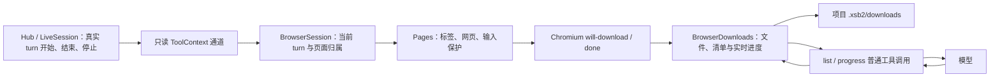

# In App Browser：受控标签、turn 下载清单与操作提示

## 最终行为

- 网站 `window.open` / `target=_blank` 一律进入应用管理的标签，无论有无 AI，不创建独立 Electron 窗口。AI 可以用普通页面工具新开、切换、关闭标签；独立窗口只由明确的 UI/工具请求创建。
- 当前 Agent turn 内，关联页面持续接管 Chromium 下载，不依赖模型用了哪个点击、按键、提交或导航工具。
- 文件保存到项目预设路径 `.xsb2/downloads/`，保留安全的默认名字，重名为 `report (1).csv`、`report (2).csv`，不覆盖旧文件或进行中的下载。
- `browser_downloads_list` 立即列当前 turn 的下载；`browser_downloads_progress(id)` 立即查询单条进度。模型按需 sleep 后再查询，工具本身不等待，也不增加模型轮次。
- 新 turn 清空可见清单，磁盘文件保留。上一轮进行中的下载之后完成，也不会重新进入新清单；旧 id 无法通过新 turn 的进度接口读取。
- Agent 控制网页时，显示红色呼吸边框及“Agent 正在操作网页”，阻止用户鼠标、键盘操作。该次工具调用结束后归还控制。Agent 的 CDP 输入和截图继续正常工作。

## 页面与输入控制

`Pages` 统一拥有网页、标签及页面窗口。网页都是主进程的 `WebContentsView`，不使用 `<webview>`/`<webview2>` 标签。显示网页的窗口（主窗口右栏与 HTML 制品预览、网页自己的窗口）抽象为 `PageHost`：窗口页面用 `renderer/page-slot.js` 按 DOM 布局量出网页区域，经 IPC（`page(id, "bounds", rect)`）同步给主进程，主进程按宿主窗口的缩放比例将 CSS 像素换算为原生视图坐标。页面里这块区域用 `mask-image` 挖空透明，网页没跟上布局的那一帧不透出底下的界面。模态对话框打开、或页面里的浮层压到这块区域时，网页先让开。只接受网页所属窗口的页面上报的位置，迟到的旧位置被忽略。

原生视图没有 zIndex，窗口里按层叠放（`ViewStack`，自下而上）：

| 层 | 内容 | 关闭方式 |
| --- | --- | --- |
| page | 当前显示的网页 | 标签切换、上报空位置 |
| control | Agent 控制蒙层：红色呼吸边框和本地化标签，和网页一样大 | Agent 工具调用结束 |
| annotation | 批注编辑框（`annotation.html`），只有编辑框那么大，按选中元素摆在其下方/上方/底部 | 保存、取消、Esc，或退出批注 |
| overlay | 覆盖层（`overlay.html`）：盖住网页的菜单，和窗口一样大 | 自己关：点外面（自带的底）、Esc、失焦 |

每次变化计算目标顺序，保留当前子视图里已按序存在的最长前缀，其余按序重新 `addChildView`（重新添加即置顶），视图不动就不碰。覆盖层按 `kind` 注册渲染器（目前是 `menu`），主进程只转交请求和答复（`overlay` / `overlayDone`，带序号，过期答复忽略）；新增一种覆盖内容只在 `renderer/overlay.js` 加一项。右栏标签的右键菜单走覆盖层；会话行仍用系统原生菜单。

网站弹出的页面：`setWindowOpenHandler` 允许弹出并用 `createWindow` 接管 Chromium 已创建的 WebContents，包进新的 `WebContentsView` 作为标签。保留 `window.opener`、POST 数据和先开 about:blank 再写内容的弹窗；不创建 BrowserWindow。模型只看到自身连接关联的页面；用户和其他 Agent 的页面不进入工具清单。HTML 制品预览继续使用独立分区，不把制品访问权限传给外部网站。

蒙层接住用户的鼠标；用户点到蒙层时键盘焦点立即还给窗口页面。批注时节点由调试器的节点选择在网页里选出，选中的元素由网页里隔离世界的脚本框住；用户选中元素后编辑框拿到焦点，关闭后焦点回到网页。提示条（提示、清除、完成）在窗口页面里、网页上方。

Debugger 截图统一由 `Pages.drawn` 提供渲染承载。显示在可见窗口里的网页在原处截图；没有显示的网页，以及显示在隐藏或最小化窗口里的网页（这样的窗口不出帧），临时放进独立的 800×600 小窗口，创建时 `show: false`，放入后仅调用 `showInactive()`。小窗口不可聚焦、忽略鼠标输入、不进入任务栏，截图成功或失败都销毁承载窗口；从窗口借出的网页截完按最新布局归还。期间切换或关闭标签时，以用户当前选择为准。主窗口的当前标签和输入焦点不参与截图。窗口无需成为前台窗口，宿主主窗口隐藏时也可截图。

新 Tab 的焦点由打开来源决定：用户打开的 Tab 自动选中，网页视图摆好后获得焦点（`page(id, "focus")`），空白新 Tab 不聚焦网页而聚焦地址栏；Agent 通过 debugger 打开的 Tab 和操作期间产生的弹出 Tab 标记为 `background`，自动切换展示并展开右栏，但不聚焦网页视图、地址栏或宿主窗口，保留用户当前输入焦点。已有页面的加载、标题和控制状态更新不再次切换标签或聚焦网页；`browser_select` 只切换 Agent 后续操作的目标，截图也不改变当前展示。

还安装主进程输入保护：用户键盘事件被阻止，可信 CDP 输入按 Chromium 的 debugger 来源标志放行；CDP 鼠标命令在受控注入窗口内放行，物理用户输入由网页之上的蒙层视图截住。没有使用 `Input.setIgnoreInputEvents`，因为它也会阻止 Agent 的 CDP 输入。页面地址栏的导航、后退、前进、刷新等操作在控制中同样被拒绝，关闭标签、停止任务等应用控制仍可用。

页面工具返回、请求被取消或浏览器连接关闭时，应用撤下蒙层并归还输入控制。蒙层由应用持有，网页快照只包含网站内容。

## turn 边界与职责



这里的 turn 是 `LiveSession.current.id` 的运行周期，不是每个工具调用，也不是每次 LLM 请求。一次 Agent turn 可以执行许多工具和 sleep，共用一份下载清单。

每个 stdio 工具服务获得独立的只读运行时凭据，绑定确定的 agent/session/server。`ToolContext.attach/current/changed` 提供实际 turn id、active 状态和近期 turn 起止区间；权限不能调用团队工具、写收件箱或发起模型请求。浏览器订阅的是运行时边界，代码接收通知，模型不用监听事件。所有权不是根据 cwd、前台标签或最近一次点击猜测。

Hub 的当前 turn 开始、结束和停止会更新浏览器：

- 开始：当前 turn 的可见下载清单从空开始。
- 结束：停止提供该 turn 的下载清单。
- 新 turn：旧下载记录不会进入新清单，旧下载完成回调仍能保存文件，但不能重新填充清单。
- 延迟到达的边界通知：下载开始时间与运行时起止区间核对，修正边界尚未同步时的归属。记录一旦对应旧 turn，其完成时不会改用新 turn。

MCP 连接内串行执行页面工具，每页独立保存 accessibility 编号和快照。下载监听独立于这些调用，因此点击返回后、sleep 期间或其他工具运行期间发生的下载仍被记录。

## 两个小接口

### browser_downloads_list

参数只有可选的 `from`，用于 20 条一页的清单分页。立即返回当前 `turnId`、预设 `directory`、`total` 及下载摘要：

```json
{
  "turnId": "turn_123",
  "directory": "/project/.xsb2/downloads",
  "downloads": [
    { "id": "download-id", "filename": "report.csv", "state": "progressing" }
  ],
  "total": 1,
  "from": 0
}
```

完成的摘要才有 `path`；失败的摘要带 `error`。没有 `waitMs`、点击参数或睡眠参数。

### browser_downloads_progress

参数只有当前 turn 中的下载 `id`，立即返回该记录的状态、字节数、百分比、观测区间内速率、暂停状态、Chromium transferState 和 done：

```json
{
  "id": "download-id",
  "filename": "report.csv",
  "state": "progressing",
  "receivedBytes": 4096,
  "totalBytes": 8192,
  "percent": 50,
  "bytesPerSecond": 2048,
  "paused": false,
  "transferState": "progressing",
  "done": false
}
```

未知总大小/百分比/速率使用 `null`。首次查询没有区间测速；速率以两次查询之间实际收到的字节变化计算。完成或失败后不再依赖 DownloadItem 对象，仍可在本 turn 查询终态。`done` 表示原生下载结束或准备阶段失败；路径只在验证成功的 completed 状态提供。

模型的可组合流程为：

1. 预期导出前查询 list 取得基线。
2. 使用普通 click/type/press_key/navigate 等工具；不必事先准确知道哪个动作会产生下载。
3. 按任务需要 sleep 后再 list，用新增 id 发现文件。
4. 对指定 id 调用 progress，根据实际进度决定继续 sleep、分析完成文件或排查失败。

空清单只能表示“目前没有观察到下载”，不代表以后不会有下载。等待时长由模型根据页面反馈和任务期限决定；接口不添加固定探测时间，也不凭空预测完成时间。

## 文件生命周期

在 `will-download` 内同步准备保存目录和文件名，调用 `setSavePath`，回调返回前完成接管。磁盘路径不可写时阻止默认下载流程并记录失败，不退回系统保存弹窗。保留 Chromium 的 cookie、重定向、POST 导出和 blob 下载，不重新发 HTTP 请求。

文件名过滤目录分隔符、控制字符、Windows 保留名和超长字节序列，其余默认名字保留。文件名使用 `open(..., 'wx')` 原子预留，多个页面、会话和进程不会抢到同一名字。预留文件不等于完成文件；`path` 在 done completed 后验证目标为真实文件、有有效内容时才交付。失败释放自身预留路径。

清单元数据放在 `.xsb2/downloads/.records/<连接 UUID>/manifest.json`，start/finish/归属修正时原子替换，进度查询直接读 Chromium，不逐块写 manifest。来源只保留 origin，不记录签名 URL query、fragment 或凭据。下载不自动执行或打开。

直接导航下载地址可能先报 ERR_ABORTED/ERR_FAILED，再触发原生下载事件。这里只针对已失败的文档加载短暂关联同一页面的实际 transfer，避免误报下载导航；普通点击不会为探测下载额外等待。

turn 结束不删除下载文件；已经开始的下载可继续完成。应用重启不恢复旧 pageId 或旧 turn 的可见清单，manifest 中的 progressing 不能被宣称为已完成。

## 已撤销的机制

下载通过页面工具和下载清单完成。浏览器通过只读 ToolContext 跟踪 turn 身份与生命周期，完成下载不会写入收件箱或唤醒模型。另见[插件向主对话发布 Markdown](../DESIGN.md#插件向主对话发布-markdown)。

## 验证

- `npm run typecheck`
- `npm test -w @xsb/desktop`
- `npm test -w @xsb/hub`
- `npm run test:browser-native -w @xsb/desktop`：项目私有 Electron，独立临时目录/profile，仅访问 localhost。焦点相关断言需要窗口能到前台（屏幕未锁定）。
- `npm run test:menus-ui -w @xsb/desktop`：验证右栏标签菜单、模态窗口让位和 HTML 制品预览往返切换。

覆盖：默认名与并发 `(1)` 后缀、预留不交付半成品、查询实时字节及未知进度、新 turn 空清单、旧 id 拒绝、旧 transfer 晚完成不串入、只读凭据不发模型消息、真实 Hub turn id 改变。

真实 Electron 覆盖：用户鼠标/键盘被阻止而 CDP 点击/输入/Enter/截图正常，红色呼吸动画及中文标签，工具调用结束后恢复用户键盘，弹出页是保留 opener 的 WebContentsView 标签、不增加 BrowserWindow，来源与 POST 保留，about:blank 弹窗可由 opener 写入；网页、蒙层、编辑框、覆盖层的层级与尺寸，覆盖层点选/点外面/Esc/失焦关闭，隐藏窗口里的网页借出截图后归还，POST/blob/直接下载保存，慢速文件的 50% 进度及跨 turn 晚完成，显式独立窗口移动和还原。
